# MonsieurCuisineCustom

**Une interface perso pour le robot Lidl Monsieur Cuisine Smart (SKMS 1200 A1)** : nouveau design,
cuisson à molettes, 16 programmes, recettes Cookomix importées et converties, envoi depuis l'iPhone.
Fork de [Camybrith Cooking](https://github.com/Tidusneo24150/camybrith-cooking) (licence MIT).

---

## 🔎 Modèles compatibles

| Modèle | Référence | État |
|---|---|---|
| **Monsieur Cuisine Smart** | **SKMS 1200 A1** | ✅ **Testé** : root, moteur, chauffe, balance, couvercle, import Cookomix |
| Monsieur Cuisine Connect | SKMC 1200 | ⚠️ **Non testé** avec ce fork. Camybrith le prend en charge en version expérimentale ([docs/CONNECT.md](docs/CONNECT.md)) ; le nouveau design n'a jamais tourné dessus |
| Autres modèles (Édition Plus, Trend…) | — | ❌ **Non testés, probablement pas compatibles** : n'essaie pas |

Configuration exacte du robot testé : Android **8.1.0**, système **V01.00.83** (juin 2022), appli
Lidl **2.22.0**, base moteur **3090**, puce MediaTek MT8167. **Une autre version du système ou de
l'appli Lidl peut se comporter différemment** : vérifie la tienne (menu ⋮ › Réglages › À propos)
et redouble de prudence si elle diffère. La référence du modèle est sur l'étiquette sous le robot.

## ⚠️ Avertissements : à lire avant tout

> **Je ne suis responsable de rien.** Ce projet est partagé tel quel, **sans aucune garantie**.
> Si ton robot ne marche plus, chauffe ou tourne quand il ne faut pas, perd ses données, ou si
> quoi que ce soit se passe mal : **c'est sous ta seule responsabilité.**

* **Rooter le robot annule probablement la garantie** et peut le rendre **inutilisable**
  (« brick ») en cas d'erreur. Fais **toujours une sauvegarde complète** avant de toucher à quoi
  que ce soit, et garde-la en lieu sûr.
* **L'appli commande un moteur et une résistance chauffante.** Fais les premiers essais **bol vide,
  couvercle fermé, la main sur l'interrupteur**. Ne laisse jamais le robot tourner sans surveillance.
* **Ne fais pas les mises à jour système Lidl** une fois rooté, et n'efface jamais la partition `cache`.
* Projet **indépendant**, sans lien avec Lidl, SilverCrest, Hoyer ni Cookomix. Les marques citées
  appartiennent à leurs propriétaires.
* **Cookomix** : l'import lit une recette à la fois, à ta demande, pour **ton usage personnel**. Les
  recettes et photos restent la propriété de leurs auteurs ; aucune n'est incluse dans ce dépôt.
  Les réglages convertis sont marqués « à vérifier » : **relis-les** avant de lancer.
* Si tu ne comprends pas une étape : **arrête-toi**. Mieux vaut demander que deviner.

## 🤖 Se faire aider par une IA (conseillé)

Le plus simple pour suivre ce tutoriel sans te tromper : **donne ce dépôt à un assistant IA**
(Claude, ChatGPT…), idéalement un assistant qui peut lire les fichiers et lancer des commandes
(par exemple Claude Code). Ouvre le dossier du dépôt avec lui et dis-lui par exemple :

> « Lis le README, docs/GUIDE.md et docs/root-sans-twrp/LISEZMOI.md, puis guide-moi pas à pas pour
> rooter mon Monsieur Cuisine Smart et installer cette appli. Demande-moi mon accord avant chaque
> écriture dans la mémoire du robot. »

Il pourra lire le code, t'expliquer chaque étape, vérifier tes sauvegardes et diagnostiquer les
problèmes. Le dépôt contient déjà des consignes pour les assistants (`CLAUDE.md`, `AGENTS.md`).
**Reste attentif quand même** : une IA peut se tromper, relis ce qu'elle te propose.

---

## Tutoriel pas à pas

Résumé ; les détails sont dans [docs/GUIDE.md](docs/GUIDE.md) (guide complet de Camybrith, PC
Windows) et [docs/root-sans-twrp/LISEZMOI.md](docs/root-sans-twrp/LISEZMOI.md) (variante Mac,
quand le tactile de TWRP ne répond pas).

1. **Vérifie ton robot** : Monsieur Cuisine **Smart** SKMS 1200 A1 (étiquette sous le robot),
   Android 8.1. Il faut un **câble USB de données** (pas un câble de charge seule) branché sur le
   port **« Android USB »** sous le robot.
2. **Sauvegarde complète** de la mémoire du robot (mtkclient ou SP Flash Tool), vérifie la taille
   de chaque fichier et copie-la en lieu sûr.
3. **Root** avec Magisk : méthode TWRP du guide, ou variante sans TWRP sur Mac.
4. **ADB Wi-Fi** : active le débogage USB dans les réglages Android (menu usine), puis vérifie
   `adb connect IP-du-robot:5555` et `adb shell su -c id` → `uid=0(root)`.
5. **Compile et installe l'appli** (JDK 17 et SDK Android) :
   ```
   ./gradlew :core:test :pilote:assembleRelease :app:assembleRelease
   adb install -r pilote/build/outputs/apk/release/pilote-release.apk
   adb install -r app/build/outputs/apk/release/app-release.apk
   adb shell cmd package compile -m speed -f app.toque     # indispensable sur ce robot
   ```
   Puis accorde le root aux deux applis dans Magisk (onglet Superutilisateur), ou utilise
   `outils/installer.sh`.
6. **Premiers essais, en mode Démo** : l'appli démarre en Démo, le moteur est simulé. Fais le tour
   des écrans.
7. **Passe au vrai moteur**, prudemment : Réglages › Machine › **Machine réelle** › Continuer, puis
   les essais du guide (étape 9) : bol vide vitesse 2 pendant 10 s ; ouverture du couvercle en
   marche (le moteur doit s'arrêter) ; 200 ml d'eau à 37 °C ; la balance.
8. **Importer des recettes Cookomix** : écran Recettes › **Importer**, colle le lien. Ou depuis
   l'iPhone avec le raccourci ci-dessous.
9. **Au démarrage du robot**, si Android demande quelle appli ouvrir, choisis l'appli, puis « Toujours ».

**Revenir à l'appli Lidl** : Réglages › Machine › « Revenir à l'appli d'origine ». **Annuler le
root** : réécris ton `boot` d'origine depuis la sauvegarde.

### Raccourci iPhone « Envoyer au robot »

App **Raccourcis** › nouveau raccourci › ⓘ › **Afficher dans la feuille de partage** (« Recevoir
URL depuis Feuille de partage »). Action **Obtenir le contenu de l'URL** :
`http://IP-du-robot:8766/importer`, méthode **POST**, corps **JSON**, champ `url` = **Entrée du
raccourci**. Ensuite, sur une recette Cookomix : **Partager › Envoyer au robot**. Sans raccourci,
ouvre simplement `http://IP-du-robot:8766` sur le téléphone et colle le lien. Pense à réserver
l'adresse IP du robot dans ta box (bail DHCP statique).

---

## Ce que ce fork ajoute à Camybrith Cooking

* **Nouveau design** clair inspiré du Thermomix TM7 : police Manrope, icônes au trait, navigation
  en pilule, rendus 3D du bol (ouvert, fermé, en chauffe, vapeur, pétrissage…).
* **Cuisson manuelle à molettes** : minutes, secondes, température et vitesse au doigt.
* **Les 16 programmes du Smart** en grille, chacun avec son rendu du bol et ses réglages.
* **Import Cookomix** : conversion des réglages Thermomix pour le Smart (Varoma → vapeur, vitesse
  cuillère → vitesse 1 en sens inverse, vitesses plafonnées en chauffe…), étapes adaptées marquées
  « à vérifier ».
* **Envoi depuis le téléphone** : petite page sur le Wi-Fi de la maison (`http://IP-du-robot:8766`,
  réseau local uniquement) et raccourci iPhone.
* **Recettes perso** : éditeur d'étapes avec réglages vérifiés par les règles de sécurité, **photo
  du plat prise avec le téléphone** via un QR code affiché sur le robot.

| | |
|---|---|
| 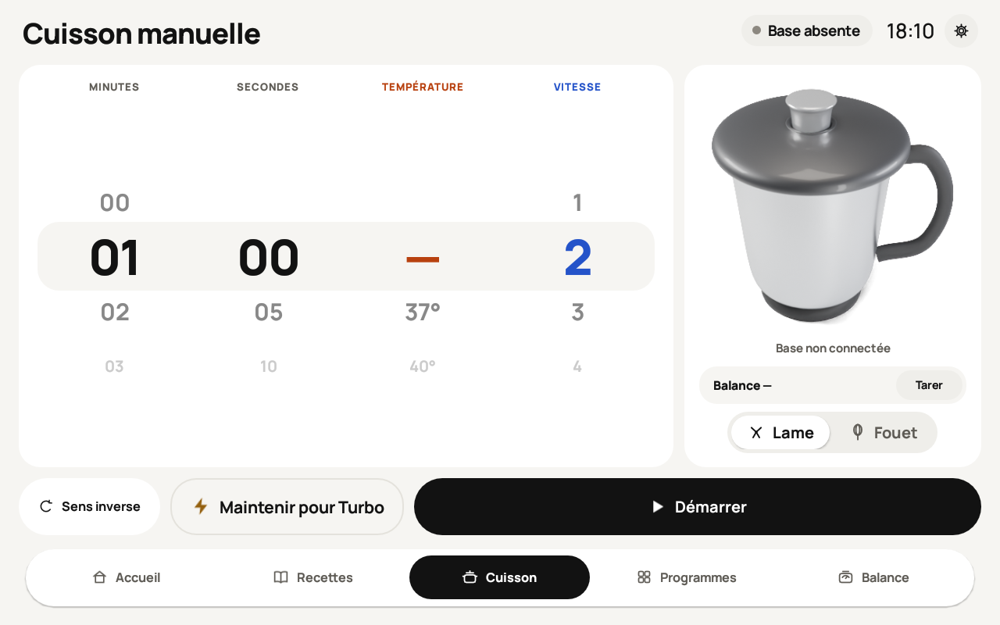 | 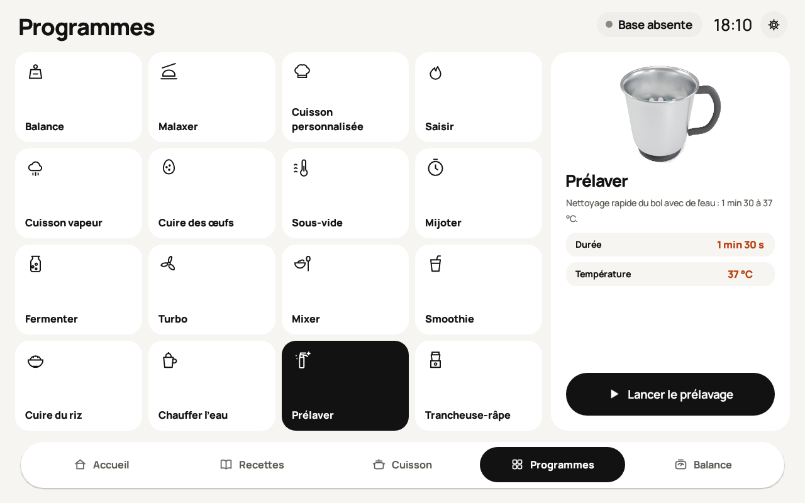 |
| **Cuisson manuelle** à molettes | **Programmes** du Smart |
| 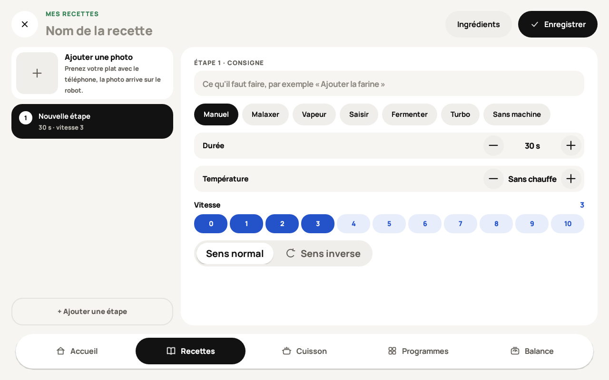 | |
| **Éditeur** de recettes perso | |

<sub>Captures prises sur le robot.</sub>

### Crédits et licence

Licence **MIT** (voir [LICENSE](LICENSE)). Tout le cœur (pilotage du moteur, sécurités, protocole)
vient de Camybrith Cooking et Toque. Police [Manrope](https://github.com/googlefonts/manrope)
(SIL OFL). Générateur de QR code d'après l'algorithme de référence de Project Nayuki (MIT).

---

## Projet d'origine : Camybrith Cooking


🇬🇧 **[English version](README.en.md)** · 🇪🇸 **[Versión en español](README.es.md)**

**Une nouvelle interface, rapide et moderne, pour le robot Lidl Monsieur Cuisine Smart (SKMS 1200 A1).**
Gratuite, libre (licence MIT), sans compte, sans abonnement, et elle marche même sans Internet.

Camybrith Cooking remplace l'appli d'origine sur la tablette du robot. Elle commande elle-même le
moteur, la chauffe et la balance, et garde les recettes officielles Monsieur Cuisine.

> **Projet indépendant**, sans lien avec Lidl, SilverCrest ou Hoyer. Il faut « rooter » le robot,
> ce qui annule probablement la garantie et comporte un petit risque de le rendre inutilisable si
> on se trompe d'étape. Le guide est écrit pour l'éviter, avec une sauvegarde complète avant de
> toucher à quoi que ce soit, mais tu fais tout **à tes risques**. Testé sur un Smart SKMS 1200 A1
> (Android 8.1, version système V01.00.83 de juin 2022) en novembre 2026.

<p align="center"></p>

<p align="center">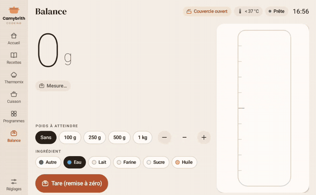<br><sub>La pesée en vrai : le bol se remplit à l'écran pendant qu'on verse.</sub></p>

| | |
|---|---|
| 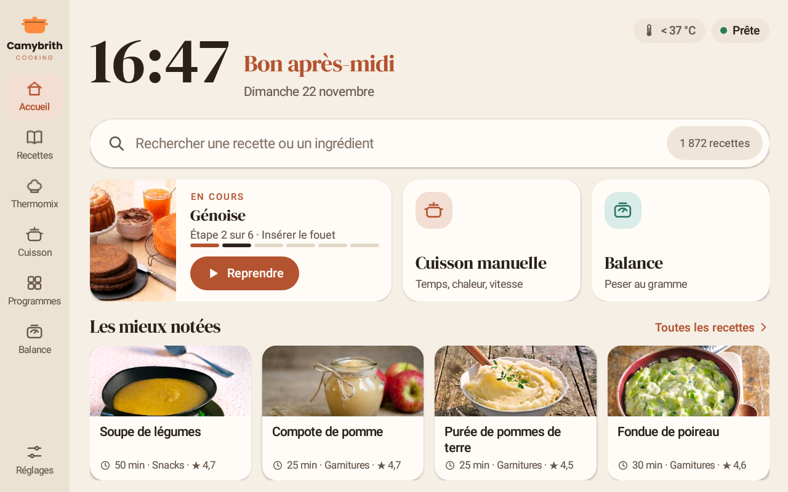 | 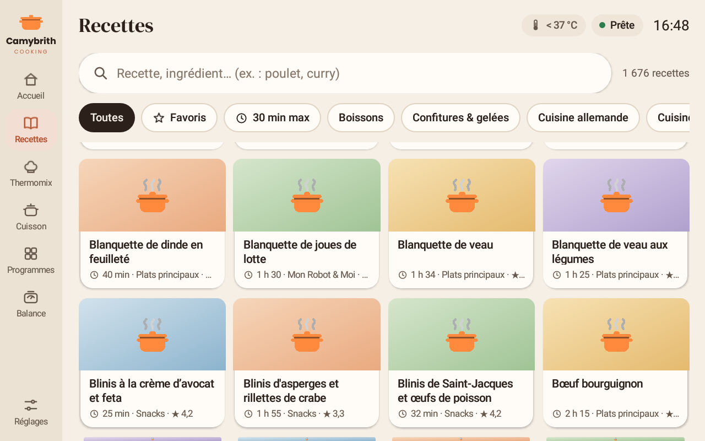 |
| **Accueil** : la recette en cours, la cuisson manuelle, la balance, les mieux notées | **Recettes** : près de 1 700 recettes Monsieur Cuisine, filtres et favoris |
| 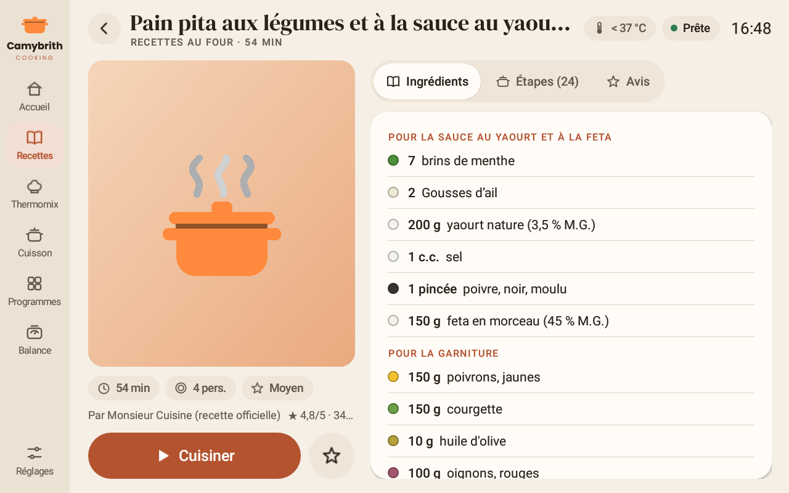 | 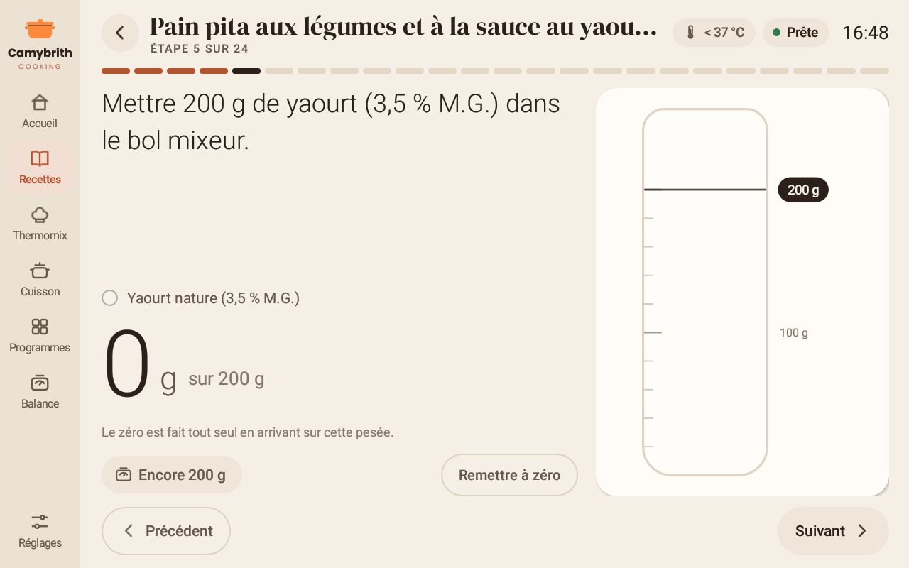 |
| **Une recette** : ingrédients, étapes, avis | **Cuisson guidée** : chaque ingrédient se pèse dans le bol, étape par étape |
| 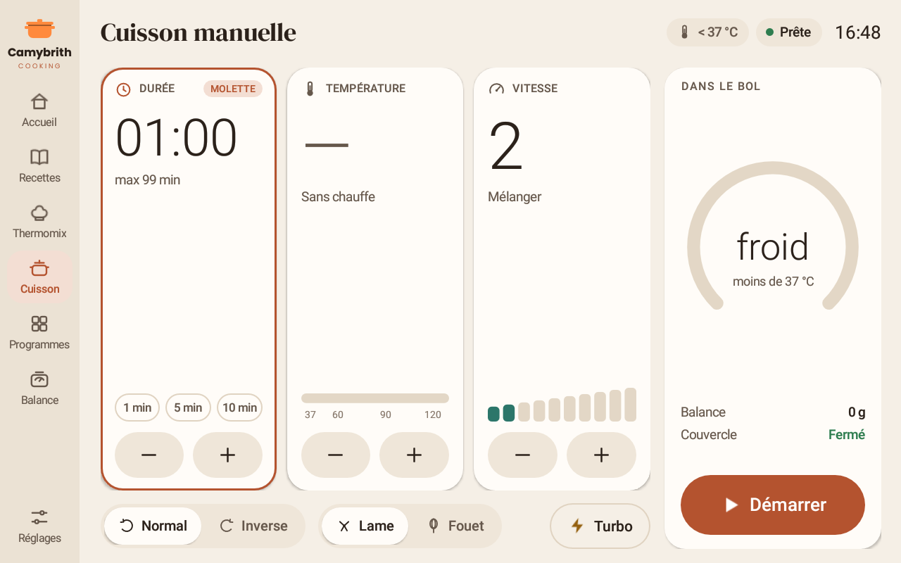 | 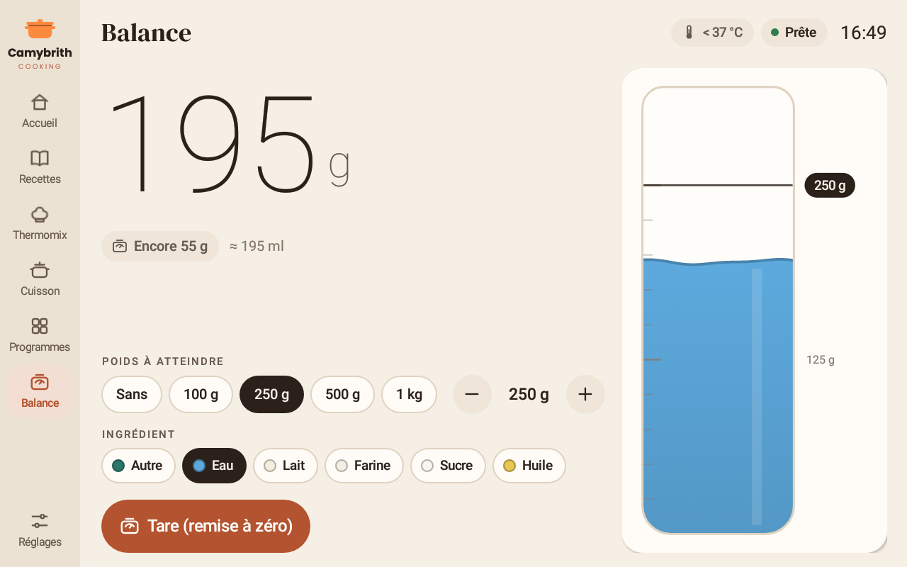 |
| **Cuisson manuelle** : durée, température et vitesse à la molette | **Balance** : le bol se remplit à l'écran jusqu'au poids voulu |
| 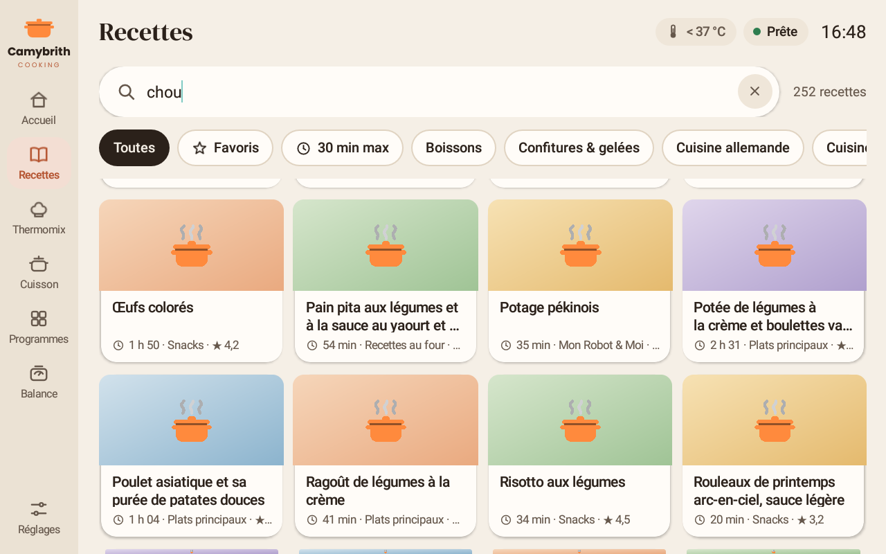 | 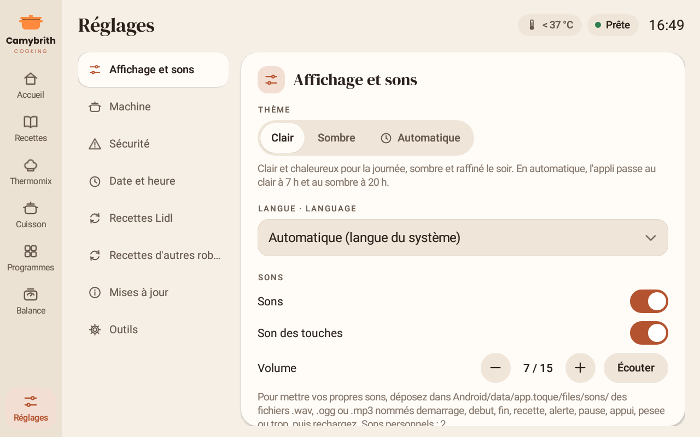 |
| **Recherche** instantanée, même avec des fautes | **Réglages** : thème clair ou sombre, langue, sons |

<sub>Captures prises sur le robot. Les photos des recettes sont celles de Monsieur Cuisine (Lidl). L'appli existe en français, en anglais et en espagnol.</sub>

## Installer

**Commence ici : [docs/GUIDE.md](docs/GUIDE.md)**, le guide pas à pas, écrit pour quelqu'un qui
n'a jamais fait ce genre de manipulation.

Il te faut :
* un **PC sous Windows** (pour l'outil qui écrit dans la mémoire du robot) ;
* un câble **USB-A mâle vers USB-A mâle** (USB 2.0) et un petit tournevis Torx ;
* le Wi-Fi de la maison ;
* deux à trois heures, sans se presser.

Une fois le robot rooté, tout le reste (installation, mises à jour, sons, logo) se fait **par le
Wi-Fi**, depuis Windows (avec Ubuntu, voir le guide), un Mac ou Linux.

## Tu as un Monsieur Cuisine Connect ?

Camybrith Cooking peut aussi tourner sur le **Connect** (SKMC 1200), en version **expérimentale** :
pas encore essayée sur un vrai Connect. Voir [docs/CONNECT.md](docs/CONNECT.md).

## Se faire guider par Claude

Tu préfères être accompagné ? Le projet fournit un **assistant prêt à l'emploi** pour Claude : il
connaît tout le guide, te fait avancer une étape à la fois, vérifie avec toi les tailles de
fichiers et les photos d'écran avant chaque étape délicate, et s'arrête si quelque chose cloche.

1. Télécharge `camybrith-assistant-claude.zip` sur la page
   [Releases](https://github.com/Tidusneo24150/camybrith-cooking/releases/latest).
2. Sur claude.ai ou dans l'appli Claude : vérifie que l'exécution de code et la création de
   fichiers sont activées dans **Réglages > Capacités**, puis va dans **Personnaliser > Skills**,
   bouton **+**, **Créer un skill**, **Importer un skill**, et choisis le ZIP.
3. Ouvre une nouvelle conversation et écris par exemple : « Je veux installer Camybrith Cooking
   sur mon Monsieur Cuisine Smart, guide-moi. »

Avec **Claude Code**, c'est encore plus simple : ouvre-le dans le dossier du projet, il trouve
tout seul ses instructions (`CLAUDE.md`) et peut lancer les scripts pour toi, en te demandant
avant chaque action sur le robot.

Sans compte Claude, tu peux aussi donner le lien de [docs/GUIDE.md](docs/GUIDE.md) à un autre
assistant et lui demander de te guider pas à pas.

## Ce que ça change

* **Une interface pensée pour l'écran et la molette du robot**, fluide sur sa petite tablette.
* **Les recettes Monsieur Cuisine du Smart**, téléchargées depuis le site public de Lidl, la nuit
  ou à la demande, avec leurs réglages, photos, notes et avis.
* **Une vraie recherche** : elle ignore les accents, les pluriels et les fautes de frappe. Recherche
  par ingrédients, filtres, favoris.
* **Cuisson guidée** : chaque étape se lance d'un appui, la suivante s'affiche toute seule, la
  pesée est intégrée (molette ou boutons +10 g et +50 g pour atteindre le poids voulu).
* **Tes propres recettes** écrites pour un autre robot (fichier JSON, voir
  [docs/RECETTES.md](docs/RECETTES.md)) : les vitesses, températures, Varoma et pétrin sont
  convertis pour le Smart, dans un onglet à part.
* **Cuisson manuelle**, vapeur, rissoler, pétrir, Turbo, balance.
* **Couvercle ouvert = pause**, et reprise d'un appui quand on le referme.
* **Hors ligne** : rien ne dépend d'un serveur.
* **Tout se personnalise** : les sons, l'animation de démarrage avec ton logo, et même le nom et
  l'icône (voir [personnalisation/LISEZMOI.md](personnalisation/LISEZMOI.md)).

## Sécurité de la cuisson

Les limites de l'appli d'origine sont toutes conservées (vitesse 3 au plus en chauffe et en sens
inverse, durées maximales, conditions du Turbo). Le couvercle, les erreurs et la fraîcheur des
informations de la base sont vérifiés **avant** chaque démarrage ; une base qui ne répond plus
arrête tout ; une alerte reste affichée tant qu'on ne l'a pas lue ; rien ne redémarre tout seul
après une pause.

La commande du moteur tourne dans **une appli à part** (le « pilote moteur ») : si l'interface
plante, la cuisson en cours n'est pas coupée. En plus, la carte du robot arrête elle-même le
moteur environ 4 secondes après la dernière commande reçue.

## Organisation du dépôt

```
docs/GUIDE.md        le guide d'installation pas à pas (commence ici)
docs/RECETTES.md     importer tes propres recettes
docs/SMART.md        notes techniques sur le Smart (protocole, programmes, essais)
outils/              scripts à lancer depuis l'ordinateur : installer, sons, animation, barre…
modules/             modules Magisk : ADB par le Wi-Fi, animation de démarrage
personnalisation/    tes sons, ton logo, et les outils pour les fabriquer
core/                logique en Kotlin pur, testée sans Android (protocole, sécurité, recettes)
commun/              code partagé entre l'interface et le pilote
pilote/              appli « pilote moteur » (app.toque.pilote)
app/                 appli interface (app.toque)
```

## Fabriquer les APK soi-même

Les APK sont fabriqués et publiés automatiquement par GitHub (onglet **Actions**, page
**Releases**). Pour les fabriquer sur ton ordinateur : JDK 17, SDK Android, puis

```
./gradlew :core:test :pilote:assembleRelease :app:assembleRelease
./gradlew -Pprudent=true :app:assembleRelease     # version prudente
```

La version **rapide** est compilée par Android avant la première ouverture (c'est ce que fait
`outils/installer.sh`) : sur ce robot, la compilation « au fil de l'eau » d'Android fait planter
l'interface. La version **prudente** n'est jamais compilée : plus lente, mais à l'abri de ce
problème.

## Ajouter une langue

L'appli est écrite en français, avec l'anglais et l'espagnol en plus. Chaque langue est un fichier de
[`app/src/main/assets/lang/`](app/src/main/assets/lang) : copie `en.json` en `de.json` par exemple,
change `"_name"` et traduis les valeurs (les clés sont les textes français, garde les `%s` et `%d`).

## Remerciements et licence

Camybrith Cooking est une adaptation au Smart de **Toque**
([Wuki60/MrCuisineVibeConnect](https://github.com/Wuki60/MrCuisineVibeConnect)), écrite pour le
Monsieur Cuisine Connect. Merci à Wuki60 et aux contributeurs de Toque.

La méthode de root vient de la communauté du dépôt
[EliasKotlyar/Monsieur-Cuisine-Connect-Hack](https://github.com/EliasKotlyar/Monsieur-Cuisine-Connect-Hack)
(discussion n° 38, en particulier depau et ihrapsa). Le root utilise
[Magisk](https://github.com/topjohnwu/Magisk).

Licence MIT : voir [LICENSE](LICENSE). Aucun code, recette ou fichier de Lidl n'est inclus dans ce
dépôt ; les seules images de Lidl sont les photos de recettes visibles sur les captures d'écran.
